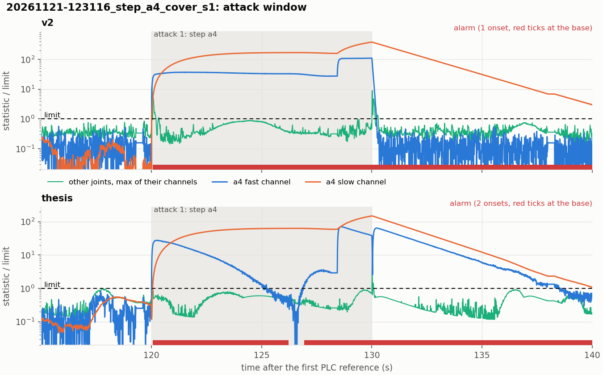

# Red-Teaming an Industrial Robot Testbed

**Physics-informed intrusion detection for a KUKA LBR iiwa in a simulated industrial cell.**

[](https://docs.ros.org/en/jazzy/)
[](https://gazebosim.org/)
[](LICENSE)
[](CHANGELOG.md)

An attacker on the network between a PLC and a robot can quietly change the robot's setpoints. This project builds that attack in a simulated cell and catches it from physics: the IDS taps the PLC's trusted reference, replays the robot's controller and dynamics, estimates the extra torque on each joint every 10 ms, and tells slow friction wear apart from an attack.

| v1.4.0, seed 1, one run each | IDS v2 | Dissertation design |
|---|---|---|
| 600 s of friction wear, no attack | **0 false alarms** | 31 false alarms as wear grows |
| +0.02 rad setpoint attack on joint a4 | **detected in 44 ms, on a4** | 114 ms, on a4 |
| Same attack, torque report also falsified | **detected in 50 ms, on a4** | 50 ms, on a4 |

v1.4 adds ten attack kinds, an attacker who hides the torque evidence, sweeps, an offline replay of recorded runs, an evaluation package and five baseline detectors.



> [!NOTE]
> These are narrow results (one seed, one attacked joint, 0.165 h of nominal data). See the full documentation for what is measured, what is only unit-tested, and the limitations.

## Quick start

```bash
git clone https://github.com/peeyushkumarmisra/red-teaming-a-industrial-test-bed.git
cd red-teaming-a-industrial-test-bed && git checkout v1.4-ids-attacks-eval
docker compose build robot ids && docker compose up -d robot ids
```

Then follow [§13–14 of the full README](README_REFINED.md#13-installation--setup) to build, calibrate and run an attack.

## Documentation

| Document | What is in it |
|---|---|
| [**README_REFINED.md**](README_REFINED.md) | The full story: objective, v1 problems, every change, algorithms, results, limitations, future work, and the challenges we solved |
| [docs/v1.4.md](docs/v1.4.md) | v1.4 release notes, results, baselines and graphs |
| [docs/v1.2.md](docs/v1.2.md) | v1.2 release notes, results and graphs |
| [docs/ARCHITECTURE.md](docs/ARCHITECTURE.md) | Nodes, topics, timing, containers, run life cycle |
| [docs/CONFIGURATION.md](docs/CONFIGURATION.md) | Every parameter and its default |
| [docs/TESTING.md](docs/TESTING.md) | Test suites, how to run them, verification status |
| [CHANGELOG.md](CHANGELOG.md) | Release history |
| [CONTRIBUTING.md](CONTRIBUTING.md) | How to work on the project |

The original dissertation code is preserved at tag [`v1.0.0`](https://github.com/peeyushkumarmisra/red-teaming-a-industrial-test-bed/tree/v1.0.0).
