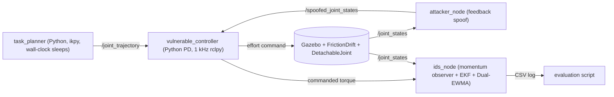
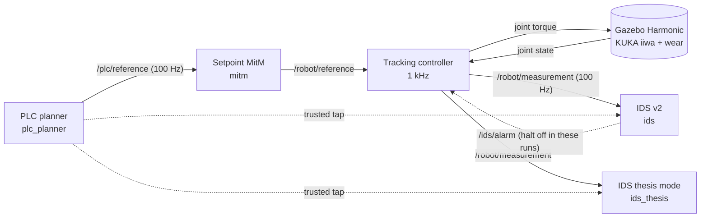
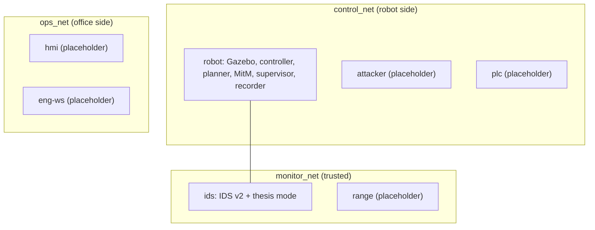
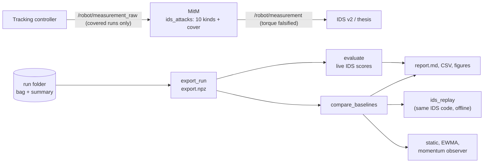
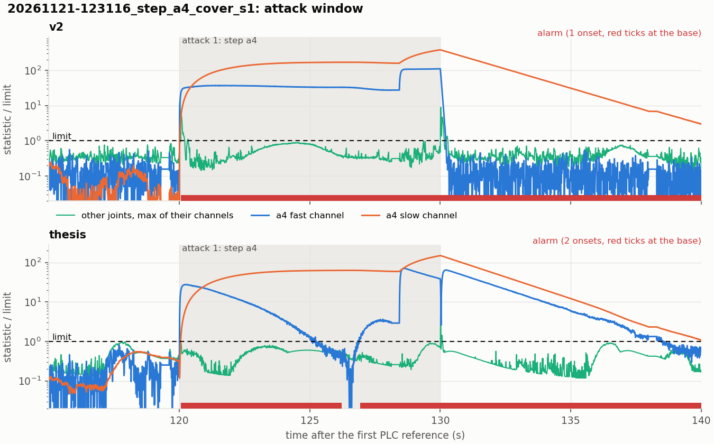
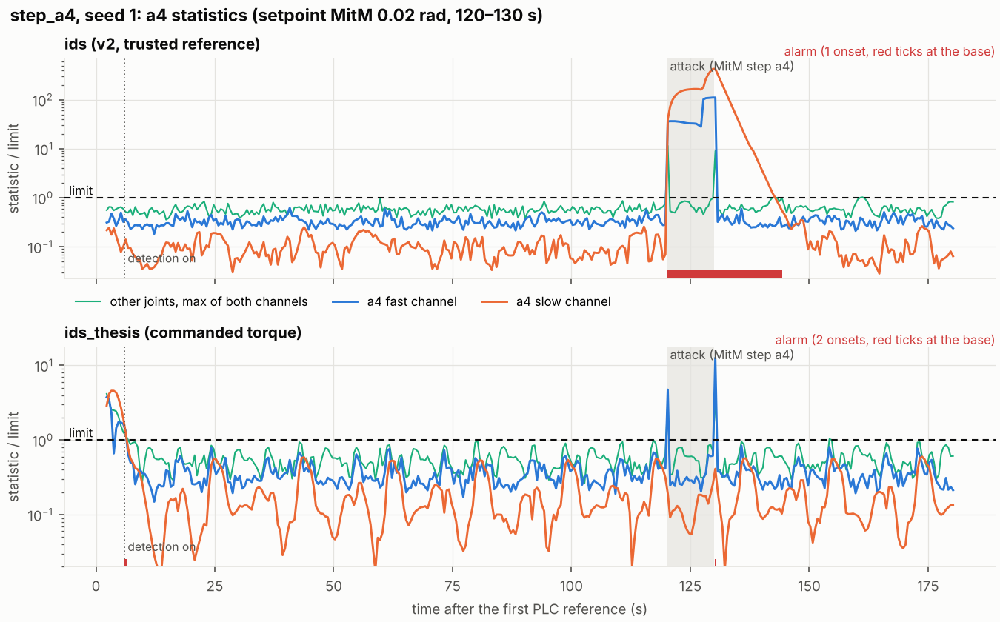

# Red-Teaming an Industrial Robot Testbed — v1.4 `v1.4-ids-attacks-eval`

### Physics-informed intrusion detection for a KUKA LBR iiwa, rebuilt so its results can be trusted

[](https://docs.ros.org/en/jazzy/)
[](https://gazebosim.org/)
[](#9-technologies-retained-introduced-and-replaced)
[](#9-technologies-retained-introduced-and-replaced)
[](LICENSE)
[](CHANGELOG.md)

> **In one sentence.** A model of the robot's physics watches all seven joints, compares how the arm actually moves with what the trusted PLC asked for, and raises an alarm when someone falsifies the setpoints on their way to the robot, while slow friction wear is learned instead of being mistaken for an attack.

> [!IMPORTANT]
> **The measured results are narrow:** seed 1 only; a 0.02 rad step on joint a4 with and without a falsified torque report; one 600 s nominal run (0.165 h). The other nine attack kinds, the sweeps, the ramp and the other six joints are *implemented and unit-tested, not run in simulation*. Per-hour false-alarm rates below come from minutes of data and are not yet statistically meaningful. See [§12](#12-measured-improvements) and [§18](#18-current-limitations).

---

## Contents

| | | |
|---|---|---|
| [1. Project overview](#1-project-overview) | [8. Architecture evolution](#8-architecture-evolution) | [15. Configuration](#15-configuration) |
| [2. Original objective](#2-original-objective) | [9. Technologies](#9-technologies-retained-introduced-and-replaced) | [16. Testing & verification](#16-testing--verification) |
| [3. Original capabilities](#3-original-capabilities-v100) | [10. Algorithms & decisions](#10-algorithms--implementation-decisions) | [17. Benchmarks](#17-benchmarks) |
| [4. Original architecture](#4-original-architecture--technologies-v100) | [11. Final capabilities](#11-final-capabilities-v140) | [18. Current limitations](#18-current-limitations) |
| [5. Original limitations](#5-original-limitations) | [12. Measured improvements](#12-measured-improvements) | [19. Future work](#19-future-work) |
| [6. Problems identified](#6-engineering-problems-identified) | [13. Installation & setup](#13-installation--setup) | [Challenges & how we solved them](#challenges-faced--how-we-solved-them) |
| [7. Key changes](#7-key-changes--rationale) | [14. Running experiments](#14-running-experiments) | [Repository layout](#repository-layout) |

---

## 1. Project overview

Industrial robots take their motion commands from a PLC over a network. An attacker who sits on that network (a man-in-the-middle, MitM) can change the setpoints slightly; the robot obeys, the product is damaged or the cell becomes unsafe, and the controller itself sees nothing wrong because it is simply following orders.

This project is a **simulated industrial robot cell used as a red-team testbed** for that threat, and an **intrusion detection system (IDS)** that catches it from physics:

- the IDS taps the PLC's reference on the **trusted** side of the network;
- it replays the robot's own controller and rigid-body dynamics to predict how each joint should move;
- it estimates, for every joint and every 10 ms, the extra torque that would explain what the encoders actually saw;
- a dual-timescale statistic separates **slow wear** (learned as friction) from **fast attacks** (alarm), and names the attacked joint.

This repository started as the code of an MSc dissertation (EMATM0055, tag `v1.0.0`). Release **v1.2.0** (branch `v1.2-ids-core-sim`) rebuilt that experiment from the ground up: correct maths, a deterministic simulation, wear that really reaches the joints, containers, tests and CI. Release **v1.4.0** (branch `v1.4-ids-attacks-eval`) adds the tools to attack and measure it properly: ten attack kinds, an attacker who also falsifies the robot's torque report, sweeps, an offline replay of recorded runs, an evaluation package and five baseline detectors. Later releases add SROS2 security (v1.6) and a full OT network with OpenPLC and Modbus (v1.8).

| | |
|---|---|
| **Robot** | KUKA LBR iiwa 14 R820 (7 joints), Gazebo Harmonic, `ros2_control` at 1 kHz |
| **Task** | Pick-and-place of a 5 kg cube between two stations, forever |
| **Wear** | Viscous friction on every joint grows 0.1 % of its initial value per second from 30 s |
| **Attack (measured)** | Setpoint MitM, +0.02 rad on joint a4 from 120 s to 130 s, with and without a falsified torque report |
| **IDS** | EKF + disturbance inversion + Dual-EWMA, two instances side by side (v2 and the dissertation's design) |
| **Headline (v1.4, one run each)** | v2: **no false alarm in 600 s of wear; attack detected 44 ms after it started, and 50 ms when the attacker also hid the torque, both on a4.** Dissertation design: 31 false alarms under wear. |

---

## 2. Original objective

From the dissertation, in its own terms:

> Decouple slow mechanical friction drift from fast false-data-injection attacks (FDIAs) using a physics-informed state observer with Dual-EWMA adaptive thresholding, keeping the **false-positive rate below 1 %** during drift and the **detection latency below 100 ms**.

v1.2 kept this objective unchanged and added what is needed to test it honestly: every joint monitored, the attacked joint named, calibrate once, and the dissertation's own design measured side by side on the same data. v1.4 adds what is needed to *measure* it: latency per attack event, false alarms per hour, attribution, harder attacks, and simpler detectors to compare with.

---

## 3. Original capabilities (v1.0.0)

What the committed v1 code did, verified against the code and its CSV log during the Phase 1 audit:

| Aspect | v1.0.0 as committed |
|---|---|
| Robot and simulation | KUKA iiwa in Gazebo, a Python PD controller on a 1 kHz `rclpy` timer, no gravity compensation |
| Attack | Feedback spoof on `/joint_states` (0.8 rad step on joint 4, 0.5 s), 6 events |
| Detection | Norm of a momentum-observer residual over all joints; the EKF ran but its result was discarded |
| Thresholding | Constant limit from a 0–30 s burn-in; slow average silently frozen while alarmed |
| Wear | FrictionDrift plugin, at most about 0.44 N·m of torque by the end of the run |
| Reported metrics | Reproduced exactly from the CSV: FPR 0.55 %, recall 57.78 %, precision 72.90 %, F1 0.6446, mean latency 25 ms |
| Build and tests | No clean build from the repository; no automated tests |

---

## 4. Original architecture & technologies (v1.0.0)



Technologies: ROS 2, Gazebo, Pinocchio, a C++ IDS node, Python controller, planner and attacker, a hand-edited `iiwa.urdf`, `run_exp.sh`, one dev container.

---

## 5. Original limitations

- **The observer could not see the attack it was meant for.** It was driven by the commanded torque, which a setpoint attacker also controls (finding **M1**).
- **The alarm did not come from the EKF**, and the momentum observer had a sign error (`C·q̇` instead of `Cᵀ·q̇`).
- **Wear was almost absent**: about 0.44 N·m at most, and the plugin's torque was probably overwritten by the controller interface.
- **All 87 false positives** came within 0.26 s after an attack ended, none at friction onset, so the wear claim was never actually tested.
- **Timing ran on the wall clock**, while the simulation ran 1.4–1.55× slower than real time.
- **The control limit was inflated about 6.9×** by the start-up transient in the burn-in window.
- **No clean build** was possible (missing dependencies, 30 hard-coded paths), there were **no tests**, and flake8 reported **218 findings**.

---

## 6. Engineering problems identified

The Phase 1 audit listed 26 defects (D1–D26) and six maths findings (M1–M6). The ones that shaped v1.2:

| ID | Problem | Consequence |
|---|---|---|
| **M1** | The innovation stays zero under a setpoint attack when the model input is the commanded torque | Drive the model from the **trusted reference** |
| **M2** | Per-joint residuals are coupled through the inverse mass matrix (a joint-4 attack appears at 82 % on joint 6) | **Disturbance inversion** d̂ = Φ⁻¹·r gives the attacked joint exactly |
| **M3** | The threshold used σ of the fast average, not of fast − slow | Exact, time-varying variance of the difference |
| **M4** | Under a linear drift fast − slow settles at 195 × slope, so wear and a slow ramp look identical | Learn friction in the EKF, plus a slow-channel detector |
| **M5** | L = 3 on correlated EWMA output gives about 700 alarm episodes per hour | Limits chosen from a **false-alarm budget per hour**, with debounce |
| **M6** | Encoder noise of 1e-4 rad² corresponds to a 7.5-bit encoder | A realistic 20-bit encoder, modelled in the controller |
| D1–D3 | Wrong residual, ill-posed EKF, wrong momentum-observer dynamics | New estimator (C05–C07) |
| D4, D5 | Burn-in transient; wall-clock timebase | Calibrate once on sim time (C11, C12) |
| D6, D24 | Payload replaced the link's mass instead of being added | Payload composition (C04) |
| D10, D12 | Wear negligible and possibly never applied | Rewritten FrictionDrift with ground truth (C14) |
| D11, D13, D25 | Torque clipping, no gravity compensation, jitter | C++ `ros2_control` controller (C13) |
| D14, D23 | Wall-clock planner, unseeded IK (wrist flips) | PLC-style planner on sim time, seeded IK (C15) |
| D16–D20 | No clean build, hard-coded paths, hand-edited URDF, no tests | Containers, xacro, tests, CI (C01, C14) |

---

## 7. Key changes & rationale

| ID | Change | Why |
|---|---|---|
| C01 | Docker images (`robot`, `ids`), 7-service Compose file, CI | Anyone can rebuild the exact environment; the IDS is isolated on the trusted network |
| C02 | `ids_interfaces` messages | One explicit contract between the cell and the IDS |
| C03 | Shared control law (`iiwa_control_law`) | The IDS replays exactly the controller's law; they can never drift apart |
| C04 | Robot model with payload composition and derivatives | Correct dynamics with the part in the gripper (D6) |
| C05 | Closed-loop model, 10 ticks per window, analytic Jacobians | Predict the arm under its own controller from the trusted reference (M1) |
| C06 | EKF with thesis and extended modes, friction states, Joseph form, χ² gate, freeze and rollback | Learn wear without learning attacks (M4) |
| C07 | Disturbance inversion d̂ = Φ⁻¹·r with one refinement | Torque per joint: the attacked joint is named (M2) |
| C08 | Dual-EWMA with exact variance, slow-channel detector, baseline freeze and rollback | Correct statistics from the first window (M3, M4) |
| C09 | Limits from a false-alarm budget, debounce, hysteresis, latch, attribution | A real false-alarm rate instead of a per-sample α (M5) |
| C10 | Command check τ_applied − τ_nominal | Second, independent check of the controller's output |
| C11 | Calibrate once, with a fingerprint | Reuse a calibration safely; refuse it for another model or other settings |
| C12 | `ids_node` on sim time, trusted tap, status/alarm/reset | Deterministic, auditable decisions, one per window |
| C13 | `ReferenceTrackingController` (C++, 1 kHz, encoder model, tick clock) | Realistic sensing and an exact timeline for the IDS |
| C14 | `iiwa_sim`: xacro at launch, FrictionDrift with ground truth | Wear really applied, and measurable |
| C15 | PLC-style planner: 10 ms scans on sim time, seeded IK, trusted context | Repeatable motion; grabs that do not cause false alarms |
| C16 | Setpoint MitM node with ground truth | The dissertation's actual threat model |
| C17 | Bringup: launches, scenarios, campaign runner, run supervisor | Unattended, recorded, health-checked runs |
| C18 | `ids_evaluation` (v1.4): run export, per-event detection and latency, false alarms per hour, attribution, per-joint table, figures, Markdown/CSV report | Results come from one tested tool, not from ad-hoc scripts |
| C19 | `ids_attacks` (v1.4): ten attack kinds with ground truth | Test the IDS against attacks shaped to look normal (freeze, replay, delay, drift-mimic), not only steps |
| C20 | Sweeps in `campaign.yaml` (v1.4) | Kind × joints × magnitudes from one entry, for minimum-detectable-attack curves |
| C21 | Offline replay: `ids_core` replay and the `ids_replay` command (v1.4) | Re-score recordings, calibrate from any nominal run, and run other designs on identical data |
| C22 | Baselines (v1.4): static threshold, single EWMA, thesis and commanded-torque replays, momentum observer | Shows what each part of the IDS adds |
| C24 | Falsified torque report, the "cover" (v1.4) | A stronger attacker who also hides the command-torque evidence |
| C23 | MEWMA | Not in v1.4: a detector maths change needs approval first |

The full list is in [`CHANGELOG.md`](CHANGELOG.md).

---

## 8. Architecture evolution

**v1.2 data flow** (the trusted tap is the key difference from v1):



**Containers and networks:**



`robot` sits on `control_net` and `monitor_net` (the `plc` placeholder on all three); `ids` sits only on `monitor_net`, so the attacker's network never reaches it. Details: [`docs/ARCHITECTURE.md`](docs/ARCHITECTURE.md).

| | v1.0.0 | v1.2.0 |
|---|---|---|
| Model input | Commanded torque | Trusted PLC reference (thesis mode kept for comparison) |
| Residual | Norm of a momentum-observer residual | Disturbance torque per joint, d̂ = Φ⁻¹·r |
| Wear handling | Slow EWMA only | EKF friction states plus the slow channel |
| Limits | Constant, from a burn-in | From a false-alarm budget, calibrated once |
| Timing | Wall clock | Simulation time, exact 10 ms windows |
| Controller | Python PD, no gravity compensation | C++ `ros2_control`, gravity feed-forward, encoder model |
| Attack | Feedback spoof | Setpoint MitM (step and ramp, any joint) |
| Build | Not reproducible | Two Docker images, CI, about 200 tests |

**v1.4 additions.** The attacker can now also relay the robot's measurements and rewrite the reported torque (C24), and every run can be scored offline:



---

## 9. Technologies retained, introduced and replaced

| Retained | Introduced | Replaced or dropped |
|---|---|---|
| ROS 2 and Gazebo | ROS 2 **Jazzy**, **Gazebo Harmonic** (gz-sim 8), pinned in Docker | Python PD controller → C++ `ros2_control` plugin |
| Pinocchio rigid-body dynamics | `ros2_control` + `gz_ros2_control` | Wall-clock task planner → PLC-style planner on sim time |
| EKF + Dual-EWMA concept | `ids_core`: ROS-free C++ detector library | `context_aware_ids` → `ids_core` + `ids_ros` |
| KUKA iiwa 14 meshes (15 of 21) | Docker Compose (`robot`, `ids` + 5 placeholders), Cyclone DDS | Hand-edited `iiwa.urdf` → launch-time xacro |
| FrictionDrift and DetachableJoint | GitHub Actions CI, gtest, pytest, flake8 | `custom_gazebo_plugins` → `iiwa_sim` FrictionDrift |
| ikpy (pinned 4.5.0) | MCAP recording, run supervisor, YAML calibration | `run_exp.sh` + CSV → launches, campaign runner, bags |
| — | `ros_gz_bridge`, `yaml-cpp` | **Dropped:** RLS estimator; `.devcontainer/Dockerfile` |
| — | v1.4: `ids_attacks`, `ids_evaluation` (NumPy, Matplotlib, `rosbag2_py`), `.npy` replay files, `ids_replay` | Offline graph scripts → `ids_evaluation`; `ids_experiments/attacks.py` → `ids_attacks` |

---

## 10. Algorithms & implementation decisions

### 10.1 Closed-loop prediction (C03, C05)

Every 10 ms window holds 10 controller ticks. For each tick the IDS computes the controller torque from the **trusted** reference with the shared law

$$\tau = K_p\,(q_{ref} - q) + K_d\,(\dot q_{ref} - \dot q) + g(q), \quad \text{clamped to the effort limits,}$$

subtracts viscous friction $b \odot \dot q$, and integrates the rigid-body dynamics (semi-implicit Euler, 1 ms). The analytic Jacobians give the state transition $F$ and the disturbance map $G$ of the window.

### 10.2 Extended Kalman filter (C06)

State $x = [q;\ \dot q;\ b]$ (21 numbers), measurement $[q;\ \dot q]$ from the encoders. Joseph-form covariance update. Friction is updated **only** in extended mode, outside alarms, and when the normalised innovation squared is under a χ² gate (36.1 for 14 degrees of freedom, about the 0.1 % tail), so an attack is not learned as friction.

### 10.3 Disturbance per joint (C07)

The prediction is anchored at the **measured** state at the start of the window, so its velocity residual $r$ only contains what happened inside the window. With $\Phi$, the map from a constant torque per joint to the end-of-window velocities,

$$\hat d = \Phi^{-1} r_{\dot q},$$

followed by one Gauss–Newton refinement (replay the window with $\hat d$ and correct the rest). For a setpoint attack of γ rad on joint *i*, $\hat d_i \approx K_{p,i}\,\gamma$ and the other joints stay near zero. $\hat d$ is standardised by its propagated covariance, so a heavy payload (which makes the arm harder to move) does not inflate it (B10).

### 10.4 Dual-EWMA statistics (C08)

Fast average (λ = 0.2, τ = 0.045 s) and slow average (λ = 0.005, τ = 2 s) of each standardised $\hat d_i$:

$$s_{fast} = \frac{|Z_{fast} - Z_{slow}|}{\sigma_D(k)}, \qquad s_{slow} = \frac{|Z_{slow}^{live}|}{\sigma_S(k)}$$

with the **exact** standard deviations after $k$ samples. During an alarm the baseline is frozen (v2 only) and, at onset, rolled back 50 windows, so the start of an attack is not absorbed.

### 10.5 Detector and limits (C09, C10, C11)

- **Alarm:** 5 windows in a row above the limit (50 ms). **Clear:** 5 windows below half the limit. **Latch:** until `/ids/reset`.
- **Limits:** a Monte Carlo of 20 hours of white noise through exactly this detector gives the limit for a budget of **0.125 false alarms per hour**, shared by every channel and joint. The scale of each statistic on calibration data accounts for real, correlated noise. Results: v2 limits 4.127 (fast) and 5.093 (slow); thesis mode 3.968 (fast; its slow statistic is computed but does not decide).
- **Warm-up:** no alarms in the first 399 windows (2 × τ_slow) after arming or reset.
- **Attribution:** at each onset, the joint whose statistic is furthest above its limit.
- **Command check (v2):** the applied torque minus the torque the trusted reference implies, through its own Dual-EWMA.
- **Context guard:** for 0.3 s after a trusted payload change the IDS re-syncs instead of detecting (grabs are not modelled).
- **Fingerprint:** SHA-256 of the parsed robot model and every detection setting. A calibration is refused if either changed.

### 10.6 Thesis mode

Same pipeline, driven by the **commanded torque**, no friction states, no baseline freeze or rollback, and only the fast channel decides. This is the dissertation's design, kept to show its blind spot on the same data.

### 10.7 Evaluation rules (C18, v1.4)

- **Detected:** an alarm onset in [start, end + 1 s]. **Latency:** onset − start (0 if an alarm was already active). **Before attack end:** the onset came while the attack was still active, not from the step back.
- **Attributed:** the primary joint at that onset is an attacked joint.
- **False alarm:** an onset after the warm-up and outside every [start, end + 30 s]; the rate is per hour of that observed time. Runs with a torque-saturation warning are excluded.
- **Baselines** get the same debounce and hysteresis as the IDS and the lowest limit that raises no alarm on the first 123 s of a nominal run (a favourable choice for them); that part is not scored.

### 10.8 Simulation decisions

- **Tick clock (B19):** the controller counts its own 1 ms ticks instead of reading the late `/clock`, so every measurement window is exactly 10 ms.
- **FrictionDrift (B14, B21):** adds $-b(t)\,\dot q$ only to a torque the controller has written, after it (priority 100), and publishes the ground truth.
- **Handover order (B23):** settle → payload context on → attach → lift on the next scan, so the grab falls inside the context guard. After each release the part is re-seated on its pad (a locating nest).

---

## 11. Final capabilities (v1.4.0)

| Capability | Status |
|---|---|
| Setpoint MitM (step) on a4 detected and attributed in Gazebo | **Measured** (v1.2 and v1.4, one run each) |
| Same attack with a falsified torque report (cover) detected and attributed | **Measured** (v1.4, one run) |
| Ten attack kinds, coordinated attacks, sweeps | Implemented and unit-tested; **only the step and the covered step run in simulation** |
| Evaluation of recorded runs: latency, false alarms per hour, attribution, figures, report | **Used** on the v1.4 runs |
| Offline replay of recorded runs with the live IDS code | **Used**; matches the live d̂ in ≥ 98.9 % of windows |
| Baseline detectors on the same recordings | **Measured** (v1.4, three runs) |
| No false alarm under wear in Gazebo | **Measured** (one 600 s run each in v1.2 and v1.4) |
| Dissertation design measured side by side (blind spot reproduced) | **Measured** (one run) |
| IDS model matches Gazebo within its noise floor; friction learned within 2 % at constant friction | **Measured** (calibration run) |
| Wear really reaches the joints (ground truth published) | **Measured** |
| Step attack on every joint detected within 100 ms and attributed | Unit-tested on a synthetic cell; **not run in simulation** |
| Slow ramp attack detected by physics alone | Unit-tested; **not run in simulation** |
| Torque tampering after the controller detected (command check) | Unit-tested; **not run in simulation** |
| IDS → robot halt chain (halt, reset, resume without a new alarm) | Unit-tested; **not run in simulation** |
| Calibrate once, fingerprint-protected | Implemented and used in every run |
| Unattended campaign with health checks and resumable runs | Implemented; used for the two regression runs |
| No memory allocation in the real-time paths | Unit-tested |

---

## 12. Measured improvements

Only measured values; "not comparable" where the two releases measured different things.

| Metric | v1.0.0 (baseline) | v1.2.0 (measured) |
|---|---|---|
| Clean build from the repository | Expected to fail (missing dependencies) | All 7 packages build in both containers, no compiler output |
| Automated tests | 0 | About 200, all passing in their last reported runs (sandbox and user's machine) |
| flake8 findings | 218 | 0 |
| Measurement timing | Wall clock; simulation 1.4–1.55× slower than the log | Every window exactly 10.000 ms |
| Heap allocations in the real-time path | Per cycle | None (tested) |
| Wear torque at the joints | At most about 0.44 N·m, probably never applied | Applied and confirmed: thesis-mode d̂ follows the true friction torque with slope 1.00–1.02 |
| Model fit (v2, calibration) | — | d̂ mean ≤ 0.006 N·m on every joint; friction a1–a6 within 2 % |
| False alarms under wear | 87 false-positive samples, all just after attacks; wear negligible | **0 alarm samples in 600 s**, friction up 57 % by the end (one run) |
| Latency, setpoint attack | Not measured (v1 attacked the feedback, 0.8 rad) | **50 ms** after the first falsified setpoint, 0.02 rad on a4 (one run) |
| Dissertation design vs setpoint MitM | Not tested | Missed it (one run) |
| IDS time per 10 ms window | Not measured | Median 181–233 µs (shared 2-core VM) |

### v1.4.0 results (seed 1, one run each)

| Run | IDS | Detected | Latency | Right joint | False alarms |
|---|---|---|---|---|---|
| `nominal`, 600 s, wear | v2 | — | — | — | **0** in 0.165 h |
| | thesis | — | — | — | 31 in 0.165 h (30 after 325 s, as wear grows) |
| `step_a4`, +0.02 rad, 120–130 s | v2 | yes, before the attack ended | **0.044 s** | a4 | 0 |
| | thesis | yes | 0.114 s | a4 | 0 |
| `step_a4_cover`, same attack + falsified torque report | v2 | yes (physics channel only; the command check was blinded) | **0.050 s** | a4 | 2 (a1, 31 s and 50 s after the attack ended; open item B16) |
| | thesis | yes | 0.050 s | a4 | 1 |

**Baselines** (trained on the first 123 s of `nominal`, scored on the rest and on both attack runs): a static threshold and a single EWMA on the same disturbance estimate detect both attacks as fast as v2 but raise 1 false alarm each in the held-out 0.131 h; the momentum observer misses the plain step and catches the covered one, because the falsified torque is its own input; the commanded-torque variant raised 18 false alarms in the cover run. Details, graphs and the discussion: [`docs/v1.4.md`](docs/v1.4.md).



*Covered attack on a4: v2 (top) is far above its limit within 50 ms although the torque report was falsified.*

### v1.2.0 regression runs

| Run | IDS | Measured |
|---|---|---|
| `nominal`, 600 s, wear | v2 | 0 alarm samples. Highest readings in the first 240 s: fast 0.955×, slow 0.745× the limit |
| | thesis | 2947 alarm samples: first-move alarm at 6.05 s (a4), then short a6 alarms from 177 s as wear grows |
| `step_a4`, +0.02 rad, 120–130 s | v2 | Alarm at 120.055 s, 50 ms after the first falsified setpoint, on a4. Peaks: fast 111×, slow 429×, command check 9022× the limit. a7 also flagged briefly at the attack edges (B4). Cleared 24.3 s after onset |
| | thesis | No alarm during the attack (4 windows over the limit at the start, one short of the debounce); 0.14 s alarm when the setpoint stepped back |



*Joint a4's fast and slow readings divided by their limits (dashed line = alarm limit), with the highest reading of the other joints. Grey band: the attack. Red ticks: alarms. v2 (top) jumps two orders of magnitude above the limit; thesis mode (bottom) barely reacts.*

More graphs and the full discussion of the v1.2 results: [`docs/v1.2.md`](docs/v1.2.md).

---

## 13. Installation & setup

**You need:** Docker (Docker Desktop with WSL2 on Windows, or Docker Engine on Linux), Git, about 15 GB of disk and 8 GB of RAM for the containers. No GPU is needed; Gazebo runs headless. Optional: VS Code with the Dev Containers extension, and an X server on Windows for the Gazebo GUI.

```bash
git clone https://github.com/peeyushkumarmisra/red-teaming-a-industrial-test-bed.git
cd red-teaming-a-industrial-test-bed
git checkout v1.4-ids-attacks-eval

docker compose build robot ids     # builds the two images
docker compose up -d robot ids     # start both containers
```

**Build the workspace inside each container:**

```bash
# robot container (VS Code "Reopen in Container", or: docker compose exec robot bash)
cd /ws && colcon build --packages-up-to ids_bringup ids_evaluation && source install/setup.bash

# ids container (docker compose exec ids bash)
cd /ws && colcon build --packages-up-to ids_ros && source install/setup.bash
```

The source folder `src/` and the results folder `data/` are shared with your machine; build output stays inside the containers.

---

## 14. Running experiments

All times are simulation time. Each run writes `data/runs/<date-time>_<scenario>_s<seed>/` with `summary.yaml` and an MCAP bag.

| Step | IDS container | Robot container |
|---|---|---|
| 1. Smoke test (60 s, IDS optional) | — | `ros2 launch ids_bringup experiment.launch.py scenario:=smoke` |
| 2. Calibrate (once) | `ros2 launch ids_ros ids.launch.py run_mode:=calibrate` | `ros2 launch ids_bringup experiment.launch.py scenario:=calibration` |
| 3. Arm the IDS | `ros2 launch ids_ros ids.launch.py` | — |
| 4. One experiment | (keep running) | `ros2 launch ids_bringup experiment.launch.py scenario:=step_a4 seed:=1` |
| 5. Regression set | (keep running) | `ros2 run ids_bringup run_campaign --only nominal step_a4 --seeds 1` |
| 6. Full campaign (45 runs, about 3 h) | (keep running) | `ros2 run ids_bringup run_campaign` |
| 7. Covered attack (v1.4) | (keep running) | `ros2 run ids_bringup run_campaign --only step_a4_cover --seeds 1` |
| 8. A sweep (v1.4; plan first) | (keep running) | `ros2 run ids_bringup run_campaign --only 'step_sweep_*' --seeds 1 --dry-run` |
| 9. Score runs (v1.4) | — | `ros2 run ids_evaluation evaluate RUN_FOLDERS... --out /ws/data/eval` |
| 10. Compare with baselines (v1.4) | — | `ros2 run ids_evaluation compare_baselines RUN_FOLDERS... --train NOMINAL_RUN --out /ws/data/compare` |

**Check a run:**

```bash
cat /ws/data/runs/*_step_a4_s1/summary.yaml      # status, alarm counts, first alarm, warnings
ros2 bag info /ws/data/runs/*_step_a4_s1/bag
```

A healthy run has `status: complete`, `torque_saturation` near 0 and no warnings. The calibration files are `data/calibration/ids_v2.yaml` and `ids_thesis.yaml`; calibrate again after any change to the robot model or the IDS settings (the IDS refuses an old one).

Scenarios: `smoke`, `calibration`, `nominal`, `step_a1` … `step_a7`, `ramp_a1` … `ramp_a7`, and from v1.4 `sine_a4`, `scaling_a4`, `freeze_a4`, `replay_a4`, `delay_a4`, `noise_a4`, `drift_mimic_a4`, `coordinated_a2a4`, `step_a4_cover`, and the sweeps `step_sweep_a<j>_m<magnitude>` and `ramp_sweep_a<j>_m<magnitude>` (see `src/ids_bringup/config/campaign.yaml`). `--rerun` repeats runs that are already complete; without it `run_campaign` skips them.

`evaluate` and `compare_baselines` write `report.md`, `events.csv`, `runs.csv`, `per_joint.csv` and figures. They read each run's bag once and cache `export.npz` in the run folder.

---

## 15. Configuration

| What | Where |
|---|---|
| IDS settings (v2 and thesis) | `src/ids_ros/config/ids.yaml`, `ids_thesis.yaml`; defaults in `src/ids_core/include/ids_core/config.hpp` |
| Controller | `src/iiwa_sim/config/controllers.yaml` |
| Friction profiles | `src/iiwa_sim/config/friction.yaml` |
| Start pose | `src/iiwa_sim/config/initial_positions.yaml` |
| Planner | parameters of `plc_planner` (station positions, heights, move times) |
| Scenarios, campaign and sweeps | `src/ids_bringup/config/campaign.yaml` |
| Attack kinds and the torque cover | `src/ids_attacks/ids_attacks/library.py`, `cover.py`; MitM parameters |
| Evaluation | command options of `ids_evaluation` (`--help`) |
| Containers and networks | `compose.yaml` |

Every IDS setting is a ROS parameter with the same dotted name (`detector.debounce`, `ekf.q_friction`, …). The full reference, with defaults and what each one does, is in [`docs/CONFIGURATION.md`](docs/CONFIGURATION.md).

---

## 16. Testing & verification

```bash
# ids container
colcon test --packages-select iiwa_control_law ids_core ids_ros && colcon test-result --verbose

# robot container
colcon test --packages-select iiwa_controllers iiwa_sim ids_attacks ids_experiments ids_bringup ids_evaluation
colcon test-result --verbose
flake8 --max-line-length 99 --extend-ignore E203 src
```

| Package | What the tests prove |
|---|---|
| `iiwa_control_law` (7) | The control law, hold, clamp and the Kp·γ signature of a setpoint attack |
| `ids_core` (65) | Dynamics and derivatives, closed-loop model, EKF, Dual-EWMA, detector, limits, fingerprint, pipeline, end-to-end attack scenarios, no allocation, offline replay |
| `ids_ros` (14) | Every parameter reaches the configuration; message conversions are exact; parameter files load for `ids_replay` |
| `iiwa_controllers` (22) | Controller state machine, encoder model, tick clock, plugin loading, and the controller–IDS contract (attack → detect → halt → resume) |
| `iiwa_sim` (18) | Wear schedule, and that the simulated robot equals the IDS's model |
| `ids_attacks` (40) | Every attack kind, its ground truth, input safety, and the torque cover |
| `ids_experiments`, `ids_bringup` | Trajectories, handover order, scenarios, IK, start-up and shutdown, campaign, sweeps, cover wiring, run files, health checks |
| `ids_evaluation` (51) | Layouts, metrics, export, baselines (incl. the momentum observer on a simulated arm), replay calls, reports, commands |

How each check was verified (sandbox, user's machine, or Gazebo), and what is still open: [`docs/TESTING.md`](docs/TESTING.md).

---

## 17. Benchmarks

`bench_ids_step` times the IDS on one 10 ms window, the real-time budget:

```bash
# after building ids_core with tests (ids container)
/ws/build/ids_core/bench_ids_step 5000
```

| Machine | Median | p90 | p99 |
|---|---|---|---|
| Shared 2-vCPU VM (Xeon 2.1 GHz), several runs | 181–233 µs | 246–324 µs | 237–427 µs |
| Development PC (Ryzen 7 5800H) | not measured yet | | |

That is about 2 % of the 10 ms budget. The GPU is not used. Not re-measured in v1.4: the live IDS code path did not change.

---

## 18. Current limitations

| Limitation | Status / plan |
|---|---|
| **Narrow results**: seed 1, attacks on a4 only (step, covered step), one nominal run of 0.165 h; per-hour rates from minutes of data; no ramp or other attack kind in simulation | Campaign and sweeps scheduled after v2.0 |
| **B4**: an attack onset that is not on a window boundary can also flag a second joint for a few windows (a7 in v1.2 `step_a4`); the main joint is still right | Results backlog (onset timing) |
| **B24**: under wear, the friction estimates trail the truth: a4 −24.6 %, a2 −13.1 % after 600 s (v1.4 run); detection was unaffected in the measured runs | Estimator decision (needs approval) |
| **B16 (v1.4)**: after the covered attack, v2 raised two short a1 alarms 31 s and 50 s after it ended; not seen after the plain attack | One run; repeat over seeds |
| **Replay timing (v1.4)**: replay assumes each reference is available by its stamp; live and replay agree in ≥ 99.9 % of windows on plain runs, 98.9 % on the covered run | Known limitation of offline replay |
| **Commanded-torque baseline (v1.4)**: false alarms vary a lot between runs (0 to 18) | Baseline result, not an IDS defect |
| a7 friction cannot be learned while a7 does not move | Candidate: stop learning on joints without motion |
| Thesis mode alarms at the first move from home and under wear (31 false alarms in 0.165 h in v1.4) | Expected: no friction model |
| 0.3 s blind window after each trusted payload change | Accepted, documented |
| The simulated gripper does not centre the part; the planner re-seats it | Simulation shortcut |
| White-box: the IDS knows the controller and taps the trusted PLC output; the PLC itself is trusted | Design assumption |
| The IDS model and Gazebo use the same URDF; only viscous wear (no Coulomb, stiction, backlash) | Real hardware needs identification |
| Ramp attacks, nine of the ten attack kinds, other joints, sweeps and the halt chain are implemented and unit-tested, not run in simulation | Results backlog |
| The torque cover assumes the attacker knows the controller gains | Design assumption (white-box attacker) |
| Results of CI runs on the pushed branches are not recorded here | Check the repository's Actions tab |

---

## 19. Future work

| Release | Branch | Adds |
|---|---|---|
| ~~v1.4.0~~ | `v1.4-ids-attacks-eval` | **Done:** evaluation, ten attack kinds, sweeps, offline replay, baselines, falsified torque report |
| **v1.6.0** | `mp-sros2` | SROS2 keystore and permissions; a rogue node without credentials is blocked; a stolen-credential MitM passes SROS2 and the IDS still catches it; IDS → robot halt chain |
| **v1.8.0** | `mp-ot-network` | OpenPLC with a structured-text sequencer, Modbus gateway, engineering-workstation update attack, attacker proxy, web HMI, recording range |
| **v2.0.0** | `mp-release` | Hardened CI, full documentation, merge into `main`, `legacy/v1` branch |

**Results backlog (after v2.0):** the 45-run campaign (seeds 1–3, all joints, step and ramp), every attack kind on every joint, the sweeps and the minimum-detectable-attack curves they feed (C25), baselines over all of it, the covered attack over seeds (B16), onset timing inside a window (B4), SROS2 overhead, Modbus attacks.

**Open estimator decisions (need approval):** MEWMA for coordinated attacks (C23), a cap on the slow channel's input (post-attack tail), a7 friction observability (v1.4 run: estimate 41× the truth, as a7 hardly moves), the position-noise setting (NIS median 4.6 against 14 expected), and friction tracking under wear (B24).

---

## Challenges faced & how we solved them

Every problem below is logged with its root cause and fix in the project's iteration log. Status: ✅ resolved, ⚠️ mitigated or open.

### In the algorithm (found in unit tests)

| # | Problem | Root cause | How we solved it | |
|---|---|---|---|---|
| B1 | A disturbance on one joint leaked up to 5.7 N·m into the others | The estimate came from the innovation, which accumulates filter error | Estimate from a prediction anchored at the measured state | ✅ |
| B2 | Friction learning gave inconsistent values in a test | The test fed 120 s of reference at once, so the arm hardly moved | Feed references as time advances, like the runtime | ✅ |
| B3 | Large disturbances on light joints leaked into others | The window map Φ is first order | One Gauss–Newton refinement (leak 0.123 → 0.00016 N·m) | ✅ |
| B4 | An attack starting mid-window can flag a second joint for a few windows | Φ assumes the disturbance lasts the whole window | Attribution of the main joint made robust; onset timing within the window is v1.4 work | ⚠️ |
| B6 | Resuming after a halt and reset raised the alarm again | The IDS predicted tracking while the controller held or blended | The controller flags any non-tracking window; the IDS skips it | ✅ |
| B8 | A calibration made with constant friction was refused in wear runs | The fingerprint hashed raw URDF text with simulator-only tags | Hash the parsed model instead | ✅ |
| B9, B10 | Grabbing the 5 kg part raised alarms | The physical grab is not modelled, and the noise scale ignored the payload | 0.3 s context guard; noise from the propagated covariance | ✅ |

### In the build and the simulation (found on the user's machine and in Gazebo)

| # | Problem | Root cause | How we solved it | |
|---|---|---|---|---|
| B12 | 4 compiler warnings in the controller | Written against an older `hardware_interface` API | `get_optional()` and checked `set_value()` | ✅ |
| B13, B14 | Gazebo ignored the friction plugin's run order | Wrong `ConfigurePriority` signature | Parameterless override, priority 100 | ✅ |
| B15 | A new run could inherit the last run's latched alarm | The node did not reset its published alarm on restart | Publish `false` on every restart | ✅ |
| B16 | The part could stay attached to the flange from start-up | The gripper attaches by default and drops early detaches | Repeat detach until the gripper reports `detached` | ✅ |
| B17 | The IDS container received nothing | DDS chose the wrong network interface | Fixed subnet and interface selection | ✅ |
| B18 | Tests errored on Jazzy's pytest 7 | A helper named `setup` is treated as a setup hook | Renamed; tests run on pytest 7 and 9 | ✅ |
| B19 | Windows of 9 or 11 ms instead of 10 | The controller timed itself by the late `/clock` | Tick clock: exactly 1 ms per update | ✅ |
| B20 | A new run attached to the previous run's Gazebo | The Gazebo server survived shutdown under a new name | Find and stop leftover servers before each run | ✅ (2 attempts) |
| B21 | Every early run started with the arm collapsed | The friction plugin's force command disabled Gazebo's joint hold | Only add to a force the controller wrote; flag saturated runs | ✅ |
| B22 | Traceback at shutdown | An interrupted message conversion raised `RuntimeError` | One tolerant shutdown helper | ✅ |
| B23 | False alarms at grabs, alarms that never cleared, part drifting | Late baseline freeze, no warm-up, grab order, no part seating | Live slow detector with rollback, warm-up, new grab order, part re-seating | ✅ (2 attempts) |
| B24 | Friction estimates trail the wear on a1–a4 | Not diagnosed; candidate: friction process noise too small | Open: needs an estimator decision | ⚠️ |

### In v1.4 (evaluation, replay and the pushed branch)

These IDs are from the v1.4 iteration log, which numbers from B1 again.

| # | Problem | Root cause | How we solved it | |
|---|---|---|---|---|
| v1.4 B1 | A replay test read a zero limit | The limit is only filled by a calibrating replay | Read it from the calibrating replay | ✅ |
| v1.4 B2 | The momentum observer showed 15.7 N·m with no external torque | Unstable test plant, and rectangle integration at 100 Hz | Stable test plant; trapezoid integration (< 0.1 N·m) | ✅ |
| v1.4 B3 | Wrong payload mass in the momentum baseline | Mass was multiplied by the context value | Mass when the context is non-zero, else 0 | ✅ |
| v1.4 B4 | Friction truth read from the wrong columns and clock | The topic holds 7 coefficients, then 7 torques, with its own stamp | Coefficient columns and the header stamp | ✅ |
| v1.4 B7 | No figures for v1.2 exports | Old exports carry no limits | `--limits` option | ✅ |
| v1.4 B8 | The thesis alarm at the attack's step back counted as a 10 s detection | No distinction between during and after the attack | "Before attack end" column; saturated runs excluded | ✅ (2 attempts) |
| v1.4 B10 | `--train <run folder>` did not match | Runs are named by folder name | Compare the folder name | ✅ |
| v1.4 B13 | The pushed v1.2 branch lacked the `ids_core` test URDF | `.gitignore` rule `data/` matched every `data` folder | Rule anchored to the root (`/data/`) | ✅ |
| v1.4 B14, B15 | Hand-edited comments broke `campaign_runner.py` and `monitor.py`, mixed up a test file, changed style settings and dropped final newlines | Code lines changed while editing comments; truncated copies | Restored from the v1.2 branch, newlines added; the commented files of this release replace them | ✅ (2 attempts) |
| v1.4 B11 | Replay differs from live in some windows | Not diagnosed: probably message arrival order | Kept as a known limitation; shown in every comparison report | ⚠️ |
| v1.4 B12 | Commanded-torque baseline false alarms vary from run to run | Not diagnosed | Reported as measured | ⚠️ |
| v1.4 B16 | Two a1 alarms after the covered attack | Not diagnosed (one run) | Repeat over seeds | ⚠️ |
| v1.4 B17 | Shutdown warning from the planner at the end of a run | rclpy executor race during SIGINT | Harmless; revisit with the v1.6 shutdown work | ⚠️ |

---

## Repository layout

```
.
├── README_REFINED.md          this document
├── CHANGELOG.md               release history
├── CONTRIBUTING.md            how to work on the project
├── LICENSE                    Apache License 2.0
├── compose.yaml               containers and networks
├── docker/                    robot and IDS images, entrypoint
├── docs/
│   ├── ARCHITECTURE.md        nodes, topics, timing, containers
│   ├── CONFIGURATION.md       every parameter
│   ├── TESTING.md             test suites and verification status
│   ├── v1.2.md, v1.4.md       release notes, results and graphs
│   └── v1.2/, v1.4/           result graphs
└── src/
    ├── ids_interfaces/        messages
    ├── iiwa_control_law/      shared control law and robot model
    ├── ids_core/              the IDS algorithm (no ROS)
    ├── ids_ros/               the IDS node and its configs
    ├── iiwa_controllers/      the ros2_control tracking controller
    ├── iiwa_sim/              Gazebo robot, wear plugin, world
    ├── ids_attacks/           attack kinds and the torque cover (no ROS)
    ├── ids_experiments/       PLC planner, MitM attacker, scenarios
    ├── ids_bringup/           launches, runs, campaign, sweeps
    └── ids_evaluation/        export, metrics, replay, baselines, reports
```

Every source file starts with a short header explaining what it does and why it matters for detecting attacks. Six files carry no comments because their formats or roles do not allow it: `src/iiwa_sim/NOTICE` (legal text), `src/iiwa_sim/env-hooks/iiwa_sim.dsv.in` (colcon hook format) and the four empty `resource/` marker files.

---

## Acknowledgements

Robot meshes and kinematic and inertial parameters come from the `iiwa_description` package of ICube-Robotics/iiwa_ros2 (Apache-2.0); see `src/iiwa_sim/NOTICE`. The detection idea comes from the author's MSc Robotics dissertation, *Physics-Informed Intrusion Detection System (IDS) for Industrial Manipulators using Adaptive Dynamic Thresholding* (EMATM0055, University of Bristol and University of the West of England, 2026).
