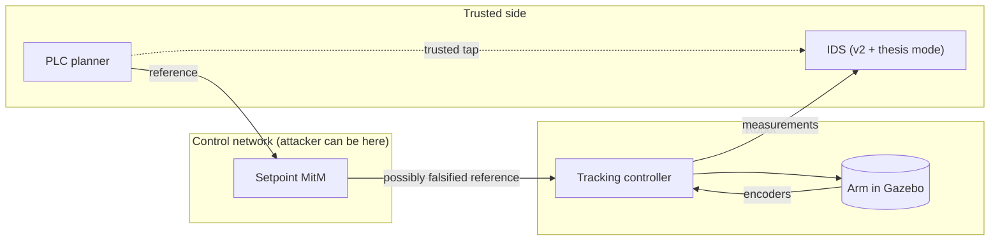
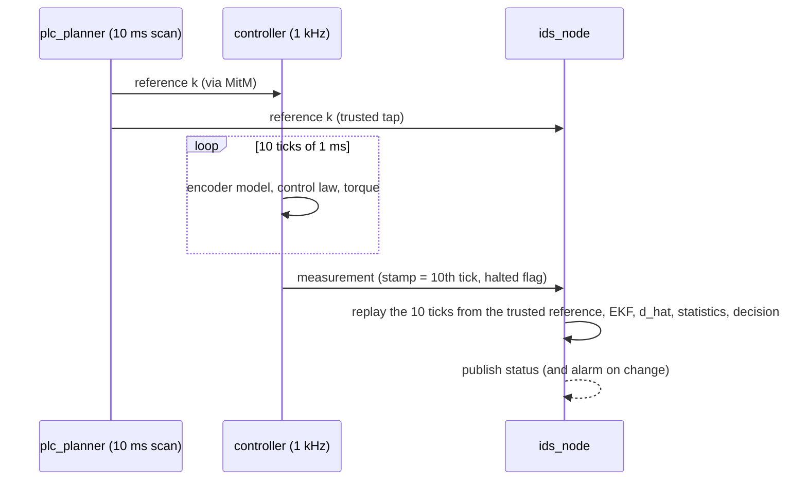
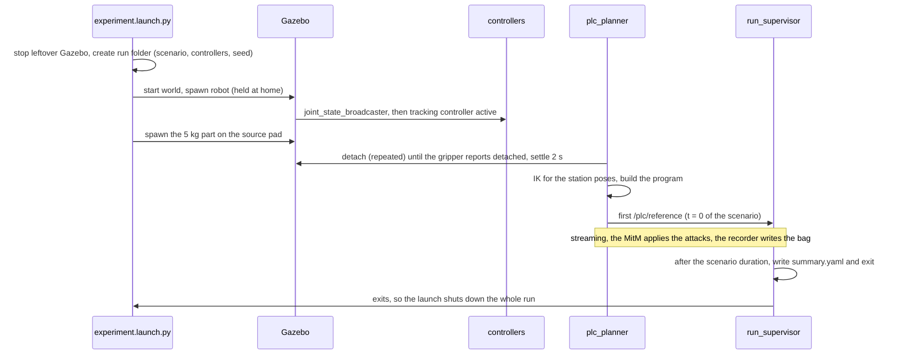

# Architecture — v1.2

How the simulated cell, the attacker and the IDS fit together: nodes, topics, timing, containers and the life of one experiment run.

---

## 1. Threat model in one picture

- **Trust anchors:** the PLC and the monitor network. The IDS reads the PLC's reference before it crosses the control network.
- **Attacker:** an implant on the control network that can change any reference sample in flight but cannot reach the monitor network.
- **White box:** the IDS knows the controller's law, gains and limits, and the robot model.
- **Out of scope in v1.2:** a compromised PLC, falsified encoder or torque reports (v1.4), network-level attacks such as Modbus (v1.8).

## 2. Packages

| Package | Language | Role |
|---|---|---|
| `ids_interfaces` | msg | `JointReference`, `JointMeasurement`, `IdsStatus`, `AttackTruth` |
| `iiwa_control_law` | C++ | Shared control law and Pinocchio robot model (used by the controller and the IDS) |
| `ids_core` | C++ | The IDS algorithm, no ROS: closed-loop model, EKF, Dual-EWMA, detector, limits, calibration |
| `ids_ros` | C++ | `ids_node`: ROS wrapper, parameters, two instances |
| `iiwa_controllers` | C++ | `ReferenceTrackingController` (`ros2_control` plugin) and its ROS-free core |
| `iiwa_sim` | C++/xacro | Robot description, FrictionDrift Gazebo plugin, world, controller config |
| `ids_experiments` | Python | `plc_planner`, `mitm`, scenario format, IK, trajectories |
| `ids_bringup` | Python | Launch files, run folders, run supervisor, campaign runner |

Dependency order: `ids_interfaces`, `iiwa_control_law` → `ids_core` → `ids_ros`; `iiwa_control_law` → `iiwa_controllers` → `iiwa_sim` → `ids_experiments` → `ids_bringup`.

## 3. Nodes and topics

| Topic | Type | Publisher → subscribers | QoS / rate |
|---|---|---|---|
| `/plc/reference` | `JointReference` | `plc_planner` → `mitm`, `ids_node` ×2, `run_supervisor` | reliable, 100 Hz |
| `/robot/reference` | `JointReference` | `mitm` → controller | reliable, 100 Hz |
| `/robot/measurement` | `JointMeasurement` | controller → `ids_node` ×2, `run_supervisor` | reliable, 100 Hz |
| `/ids/status`, `/ids_thesis/status` | `IdsStatus` | `ids_node` → `run_supervisor`, recorder | reliable, one per window |
| `/ids/alarm`, `/ids_thesis/alarm` | `std_msgs/Bool` | `ids_node` → controller (`/ids/alarm`) | reliable, transient-local, on change |
| `/ids/reset`, `/ids_thesis/reset` | `std_srvs/Trigger` | operator → `ids_node` | service |
| `/attack/truth` | `AttackTruth` | `mitm` → recorder | per forwarded sample (evaluation only) |
| `/sim/friction_truth` | `ros_gz_interfaces/Float32Array` | FrictionDrift (bridged) → recorder | 100 Hz, no header |
| `/gripper/attach`, `/gripper/detach` | `std_msgs/Empty` | `plc_planner` → gripper (bridged) | on command |
| `/gripper/state` | `std_msgs/String` | gripper (bridged) → `plc_planner` | on change |
| `/world/cell/set_pose` | `SetEntityPose` service | `plc_planner` → Gazebo (service bridge) | after each release |
| `/robot_description` | `std_msgs/String` | `robot_state_publisher` → `ids_node`, `plc_planner` (the controller gets the same description through `controller_manager`) | transient-local |
| `/clock` | `rosgraph_msgs/Clock` | Gazebo (bridged) → every node | simulation time |

## 4. Timing: one IDS window

- **Simulation time everywhere.** Gazebo steps 1 ms; `gz_ros2_control` calls the controller once per step.
- **Tick clock.** The controller stamps by counting its own updates (first update + n × 1 ms), so every measurement is exactly 10 ms after the last. The late, uneven `/clock` from the bridge is not used for stamps (B19).
- **Windows the IDS skips** (and re-syncs on): any window where the controller was not purely tracking (`halted`), the 0.3 s after a trusted payload change, and implausible gaps.
- **Budget.** The IDS takes about 0.2 ms per 10 ms window (sandbox measurement).

## 5. Containers

| Service | Image | Networks | Runs |
|---|---|---|---|
| `robot` | `docker/robot.Dockerfile` (ROS 2 Jazzy desktop, Gazebo Harmonic) | `control_net`, `monitor_net` | Gazebo, controller, planner, MitM, supervisor, recorder |
| `ids` | `docker/ids.Dockerfile` (ROS 2 Jazzy base, Pinocchio, no Gazebo) | `monitor_net` | `ids_node` ×2 |
| `plc`, `attacker`, `eng-ws`, `hmi`, `range` | `ros:jazzy-ros-core` (placeholders, profile `planned`) | various | nothing yet |

Cyclone DDS in `robot` and `ids` is pinned to the `monitor_net` address (`10.203.20.0/24`); without it, the robot can advertise its topics on the wrong interface and the IDS sees nothing (B17).

## 6. Life of one experiment run

The IDS runs in its own container across runs. When simulation time jumps back at the start of a new run, it rebuilds itself, clears its alarm and starts again (B15).

## 7. Run outputs

`data/runs/<YYYYmmdd-HHMMSS>_<scenario>_s<seed>/`:

| File | Content |
|---|---|
| `scenario.yaml` | The scenario the MitM used |
| `controllers.yaml` | Controller settings with this run's seed and halt setting |
| `summary.yaml` | `status` (complete / no_reference / interrupted), elapsed time, reference and measurement counts, per-IDS status counts, modes, alarm samples, first alarm relative to the first reference, torque saturation, warnings |
| `bag/` | MCAP recording of the topics above, recorded in simulation time |

Use `IdsStatus` (one stamped message per window) for evaluation, not the alarm topic. A run with more than 1 % of windows at a torque limit is flagged as not nominal and must be excluded.
