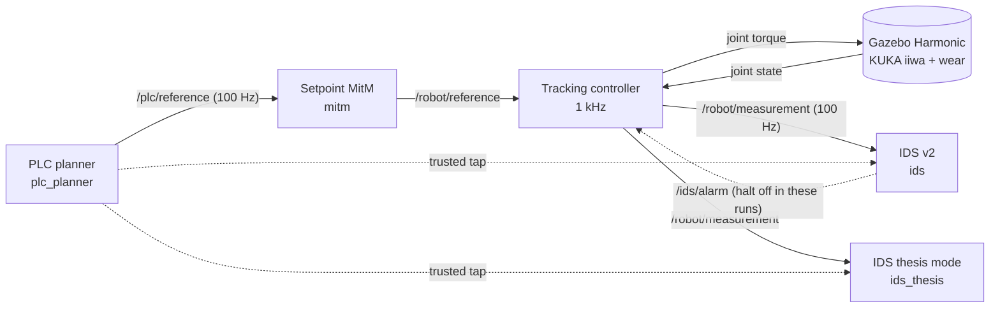
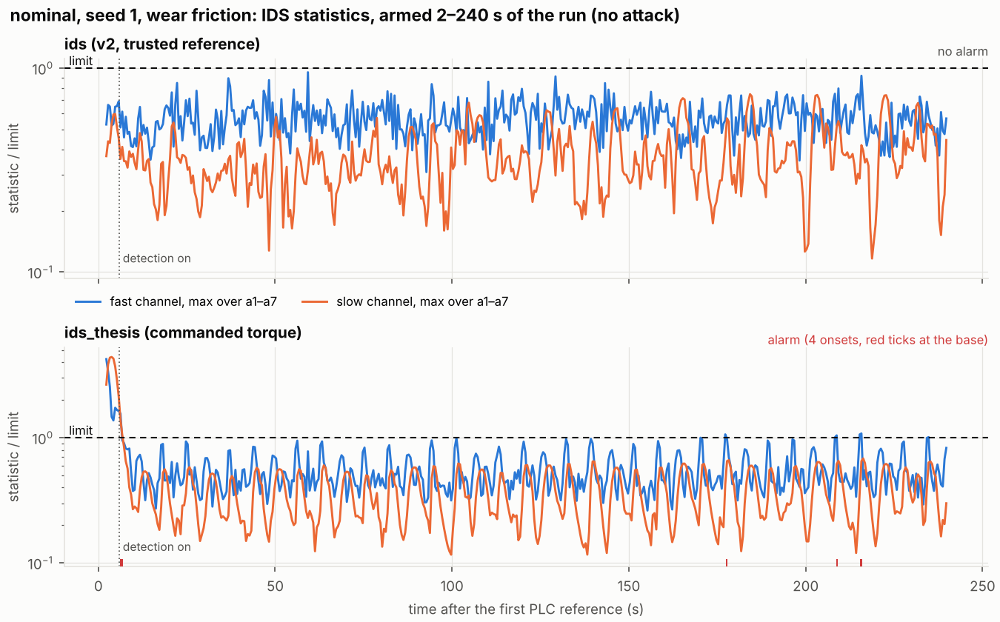
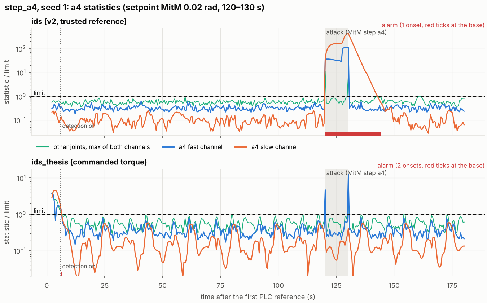
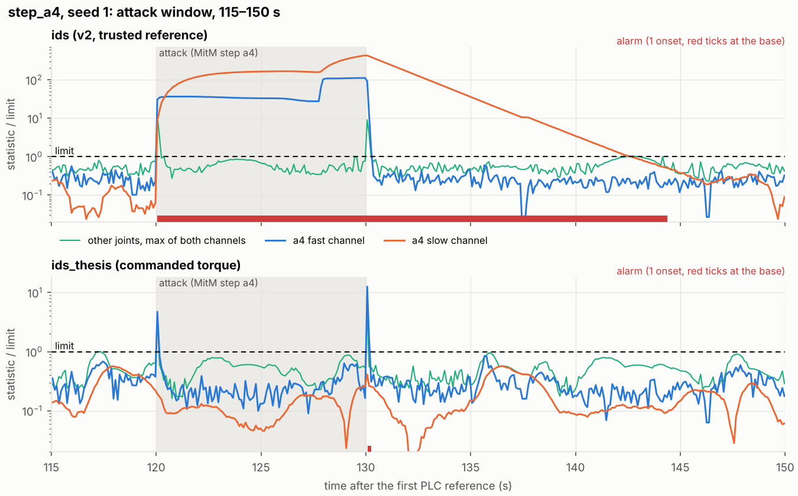
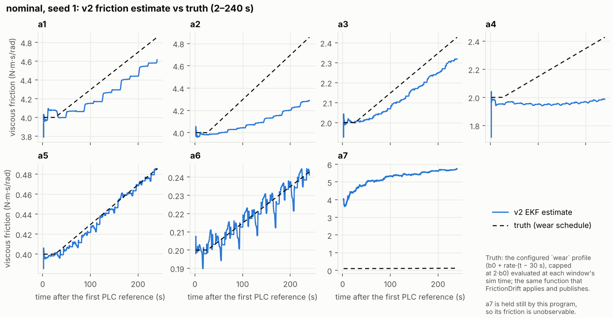

# v1.2.0 · `mp-core-sim` — the dissertation experiment, rebuilt

> **In one sentence:** a physics model of the KUKA LBR iiwa watches all seven joints, compares how the arm moves with what the trusted PLC asked for, and raises an alarm when someone tampers with the setpoints on the way to the robot, while slow friction wear is learned instead of flagged.

| | |
|---|---|
| **Release** | `v1.2.0`, branch `mp-core-sim`, built on `v1.0.0` (the dissertation code) |
| **Date** | 2026-11-20 |
| **Stack** | ROS 2 Jazzy · Gazebo Harmonic (gz-sim 8) · `ros2_control` · Pinocchio · C++20 · Python 3.12 · Docker Compose |
| **Status** | Built and tested; the regression set (two runs) measured in Gazebo |
| **Next** | `v1.4.0` `mp-attacks-eval`: evaluation package, all ten attack kinds, sweeps, offline replay, baselines |
| **Full documentation** | [`README_REFINED.md`](../README_REFINED.md) |

> [!IMPORTANT]
> **The results in this release are narrow.** They come from **one seed, one attack on joint a4 and one nominal run**. There is **no per-hour false-alarm rate, no ramp-attack result and no result for the other six joints** yet. The full campaign (45 runs) is in the results backlog after v2.0.

---

## Contents

1. [What this release does](#1-what-this-release-does)
2. [The cell at a glance](#2-the-cell-at-a-glance)
3. [How the IDS decides](#3-how-the-ids-decides)
4. [Results](#4-results)
5. [Against the dissertation hypothesis](#5-against-the-dissertation-hypothesis)
6. [Problems found and fixed](#6-problems-found-and-fixed)
7. [Known limits and open items](#7-known-limits-and-open-items)
8. [Reproduce the runs](#8-reproduce-the-runs)
9. [What comes next](#9-what-comes-next)

---

## 1. What this release does

The dissertation asked whether a physics-informed state observer with dual-timescale thresholds can keep false alarms below 1 % while friction slowly wears, and still detect an abrupt false-data-injection attack (FDIA) in under 100 ms.

v1.2 rebuilds that experiment so the answer can be trusted:

- **The IDS watches what the attacker cannot touch.** In the new (v2) mode it predicts the arm's motion from the trusted PLC reference, not from the controller's commanded torque, which a setpoint attacker controls.
- **Every joint is monitored**, and each alarm names the joint that was attacked.
- **Wear really reaches the joints.** The friction plugin now adds its torque to every joint and publishes the ground truth.
- **Calibrate once, reuse many times.** A calibration file is tied to the robot model and the IDS settings by a fingerprint.
- **The dissertation's design runs alongside** (thesis mode), on the same data, for a fair comparison.
- **The build is reproducible**: two working Docker containers (plus five placeholders for later releases), a CI workflow and about 200 automated tests.

The full list of changes, by change ID, is in [`CHANGELOG.md`](../CHANGELOG.md).

---

## 2. The cell at a glance



| Container | What runs in it |
|---|---|
| `robot` | Gazebo (headless), the tracking controller, the PLC-style planner, the MitM node, the run supervisor and the rosbag recorder |
| `ids` | Two IDS instances: `ids` (v2) and `ids_thesis` (the dissertation's design). It sits on the trusted `monitor_net` network |
| `plc`, `attacker`, `eng-ws`, `hmi`, `range` | Idle placeholders (profile `planned`) for the OT network in later releases |

**The task:** the arm shuttles a 5 kg workpiece between two stations, again and again, while the friction in every joint grows by 0.1 % of its starting value per second from 30 s onward.

**The attack:** the MitM node sits between the PLC and the robot. In `step_a4` it adds 0.02 rad to joint a4's setpoint from 120 s to 130 s. The controller obediently follows the falsified setpoint.

---

## 3. How the IDS decides

Every 10 ms the IDS takes one step:

1. **Listen to the trusted reference.** It reads the PLC's setpoints before they cross the network the attacker can reach.
2. **Predict the motion.** It runs the same control law as the controller, with the same gains, on a Pinocchio model of the iiwa, and predicts where each joint should be.
3. **Estimate a disturbance per joint.** An extended Kalman filter (EKF) compares the prediction with the encoders and turns the difference into the extra torque, in N·m, that would explain it. The torque is then scaled by its expected noise, so every joint is judged on the same scale.
4. **Learn the wear.** In v2 mode the EKF also estimates each joint's viscous friction, so slow wear is learned, not flagged.
5. **Compare two speeds.** A fast average (time constant 0.045 s) reacts within tens of milliseconds; a slow average (2 s) follows gradual change. In v2 an alarm needs the fast-minus-slow statistic, or the slow statistic itself, above its limit; thesis mode uses only the fast-minus-slow statistic.
6. **Wait for evidence.** The statistic must stay above the limit for 5 windows (50 ms) in a row before the alarm rises. It clears after 5 windows below half the limit. The alarm stays latched until someone calls `/ids/reset`.
7. **Check the torque too (v2).** The command check compares the torque the controller applied with the torque the trusted reference would have produced.

**Calibration.** One 120 s run with constant friction sets each joint's normal mean and scale. The limits come from a false-alarm budget of 0.125 alarms per hour: 4.127 (fast) and 5.093 (slow) for v2, and 3.968 and 4.866 for thesis mode.

**Thesis mode** is the same pipeline driven by the commanded torque, with no friction states, no baseline freeze, no slow detector and no command check: only the fast channel decides. It is the dissertation's design, kept for comparison.

---

## 4. Results

Both runs were recorded in Gazebo on the development PC (A-v1.2-v17 code, seed 1, calibration run 5). Alarm counts come from each run's `summary.yaml`; the graphs and the finer numbers come from an export of the recordings (`nominal`: first 240 s of 600 s; `step_a4`: all 180 s).

### 4.1 Headline

| | `nominal` — 600 s, friction wear, no attack | `step_a4` — +0.02 rad on a4 from 120 s to 130 s |
|---|---|---|
| **IDS v2** | ✅ **0 alarm samples** in 600 s | ✅ **Alarm 50 ms** after the first falsified setpoint; main joint **a4** |
| **IDS thesis mode** | ⚠️ 2947 alarm samples: one at the first move from home, then short a6 alarms from 177 s as wear grows | ❌ **No alarm during the attack**; a 0.14 s alarm when the setpoint steps back at 130 s |
| **Robot** | 0 % of windows at a torque limit | 0 % of windows at a torque limit |

### 4.2 Details

| Run | IDS | Measured |
|---|---|---|
| `nominal` | v2 | 0 alarm samples in 600 s. Highest readings in the exported 240 s: fast 0.955× and slow 0.745× the limit |
| | thesis | 2947 alarm samples in 600 s. In the exported 240 s: a4 at 6.05 s (0.91 s long), then a6 at 177.4 s, 208.6 s and 215.4 s (0.5–0.6 s each). The 6.05 s alarm comes in the first windows after detection starts (6.0 s); a4 had peaked at 4.4× the limit at 3.6 s, during the first move from home |
| `step_a4` | v2 | a4 above the limit from 120.015 s; alarm at 120.055 s, on the 5th window (the debounce minimum). That is 50 ms after the first falsified setpoint (120.005 s). Peak readings: fast 111×, slow 429×, command check 9022× the limit. Main joint a4 throughout; a7 was also flagged for 0.15 s at the start and 0.24 s at the end of the attack (open item B4). The alarm condition cleared at 144.4 s, as the slow average decayed. No other alarm; outside the attack the highest readings were fast 0.948× and one single slow window at 1.029× (too short to count) |
| | thesis | a4 above the limit for 4 windows at the attack start (peak 4.7×): one window short of an alarm. Alarm 130.095–130.235 s (peak 12.6×) when the setpoint stepped back. First-move alarm at 6.05 s |

### 4.3 Graphs

**Detection statistics, `nominal` run (no attack).** Each line is the highest reading over the seven joints, divided by its limit, so the dashed line at 1 is the alarm limit. Red ticks along the bottom mark alarms.



**Detection statistics, `step_a4` run.** Joint a4's fast and slow readings, and the highest reading of the other six joints. The grey band is the attack.



**The attack window up close (115–150 s).** v2 alarms on a4 at the start of the attack and stays alarmed until the slow average decays. Thesis mode only crosses the limit briefly at the start (4 windows, not enough for an alarm) and when the setpoint steps back.



**Friction: v2 estimate against the truth, `nominal` run.** The truth is the configured wear profile at each window's simulation time; the friction plugin applies and publishes this same function.



| Joint | a1 | a2 | a3 | a4 | a5 | a6 | a7 |
|---|---|---|---|---|---|---|---|
| Estimate vs truth at 239 s | −5.5 % | −11.7 % | −4.4 % | −18.0 % | −0.1 % | +0.6 % | not observable |

The estimates stay within 3 % until the wear starts at 30 s, then fall behind on a1–a4 (open item B24). The detector was not affected in this run: v2 raised no alarm, because the slow average absorbs what the friction estimate misses. Joint a7 hardly moves in this program, so its friction cannot be learned.

---

## 5. Against the dissertation hypothesis

| Hypothesis | v2 on these two runs | Thesis mode on these two runs |
|---|---|---|
| False alarms below 1 % while friction wears | No false alarm in 600 s of wear | Alarms at the first move and, later, on a6 as wear grows |
| Detect an abrupt FDIA in under 100 ms | 50 ms after the first falsified setpoint | Missed: the commanded torque follows the falsified setpoint, so the model sees nothing unusual (the blind spot found in the v1 audit, now reproduced in Gazebo) |

This is consistent with the hypothesis for v2, **on one run each**. A rate needs the full campaign.

---

## 6. Problems found and fixed

Each row is logged in full, with root cause and fix, in the project's iteration log (Document B).

| ID | What went wrong | Why | Fix |
|---|---|---|---|
| B6 | After a halt and a reset, resuming tracking raised the alarm again | The IDS predicted normal tracking for windows in which the controller was holding or blending back in | The controller marks such windows as halted; the IDS skips them and re-syncs |
| B8 | A calibration made with constant friction was refused in wear runs | The fingerprint hashed the raw URDF text, which includes simulator-only settings | The fingerprint now hashes the parsed robot model plus the IDS settings |
| B9, B10 | Picking up the 5 kg part raised alarms | The payload change and the physical grasp cannot happen at the same instant, and the noise scale ignored the payload | A 0.3 s guard after each trusted payload change; noise scaled per window from the filter's covariance |
| B14 | Gazebo ignored the friction plugin's run-order setting | Wrong signature for gz-sim's priority method | Correct method; priority 100 runs it after the controller's write |
| B16 | The gripper could hold the part rigidly from start-up | The gripper plugin attaches by default and drops an early detach | The planner repeats detach until the gripper reports `detached` |
| B17 | The IDS container received nothing | DDS picked the wrong network interface | `monitor_net` has a fixed subnet and DDS is told to use it |
| B19 | Measurement windows were 9 or 11 ms instead of 10 | The controller took its time from a `/clock` that arrives late under load | The controller counts its own ticks: exactly 1 ms each |
| B20 | A new run attached to the previous run's Gazebo | The Gazebo server survived shutdown | Leftover Gazebo servers are stopped before each run |
| B21 | Every early run started with the arm collapsed | The friction plugin's force command disabled Gazebo's hold on the joints | The plugin only adds to a force the controller has written |
| B22 | The planner printed a traceback at shutdown | An interrupted message conversion raised an unexpected error | Both nodes shut down through one tolerant helper |
| B23 | False alarms at every grab, and alarms that never cleared | Baseline frozen too late, start-up warm-up, grab order, and a part drifting on the floor | Live slow detector with rollback, 4 s warm-up, guard covers the grab, and parts re-seated at each station |

---

## 7. Known limits and open items

| Item | Status |
|---|---|
| **B4** — an attack that does not start on a window boundary can also flag a second joint for a few windows (a7 in `step_a4`). The main joint is still right | Open; onset timing inside the window is planned for v1.4 |
| **B24** — under wear, v2's friction estimates on a1–a4 fall behind the truth | Open; changing the estimator needs a separate decision |
| Joint a7's friction cannot be learned while a7 does not move | Known; candidate fix: stop learning on joints that are not moving |
| Thesis mode alarms at the first move from home and later under wear | Expected for the dissertation's design: it has no friction model |
| For 0.3 s after each trusted payload change, the IDS re-syncs instead of detecting | Accepted blind window, documented |
| The simulated gripper does not centre the part; the planner re-seats it at each station (like a locating nest) | Simulation shortcut |
| The IDS model and Gazebo use the same URDF | Real hardware would need parameter identification |
| IDS step time (median 181–233 µs per 10 ms window) was measured on a shared 2-core VM only | Not yet measured on the target PC |
| Implemented and unit-tested but **not run in simulation**: ramp attacks, attacks on a1–a3 and a5–a7, the halt-on-alarm chain | Planned for the results backlog and v1.6 |
| The graphs were drawn with offline scripts that are not yet in the repository | `ids_evaluation` (C18) in v1.4 |
| CI workflow | First runs on this push |

---

## 8. Reproduce the runs

**Windows PowerShell**, in the repository folder:

```powershell
docker compose up -d robot ids
```

**Robot terminal** (VS Code attached to `robot`) and **IDS terminal** (`docker compose exec ids bash`):

```bash
# robot terminal: build
cd /ws && colcon build --packages-up-to ids_bringup && source install/setup.bash

# IDS terminal: build, then start calibration mode (it saves the files and exits)
cd /ws && colcon build --packages-up-to ids_ros && source install/setup.bash
ros2 launch ids_ros ids.launch.py run_mode:=calibrate

# robot terminal: 130 s calibration run with constant friction
ros2 launch ids_bringup experiment.launch.py scenario:=calibration

# IDS terminal: start both IDS instances armed
ros2 launch ids_ros ids.launch.py

# robot terminal: the regression set (nominal 600 s, then step_a4 180 s)
ros2 run ids_bringup run_campaign --only nominal step_a4 --seeds 1
```

Each run writes `/ws/data/runs/<date-time>_<scenario>_s<seed>/` with `summary.yaml` (status, alarm counts, first alarm, torque saturation, warnings) and `bag/` (MCAP recording of every topic the evaluation needs).

---

## 9. What comes next

| Release | Adds |
|---|---|
| **v1.4.0** `mp-attacks-eval` | The evaluation package (latency, false alarms per hour, per-joint table, plots), all ten attack kinds, a sweep runner, offline replay, baselines, falsified torque reports |
| **v1.6.0** `mp-sros2` | SROS2 security, a rogue node without credentials, a stolen-credential MitM, the IDS → robot halt chain |
| **v1.8.0** `mp-ot-network` | OpenPLC, Modbus, an attacker proxy, an HMI and a recording range |
| **v2.0.0** `mp-release` | Hardened CI, full documentation, merge into `main` |

The campaigns that turn these single runs into rates (seeds 1–3, all joints, step and ramp) are scheduled after v2.0.
