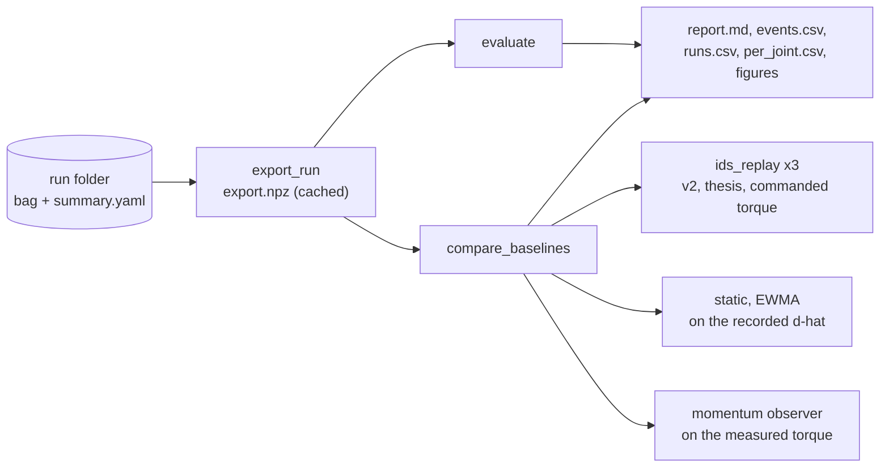
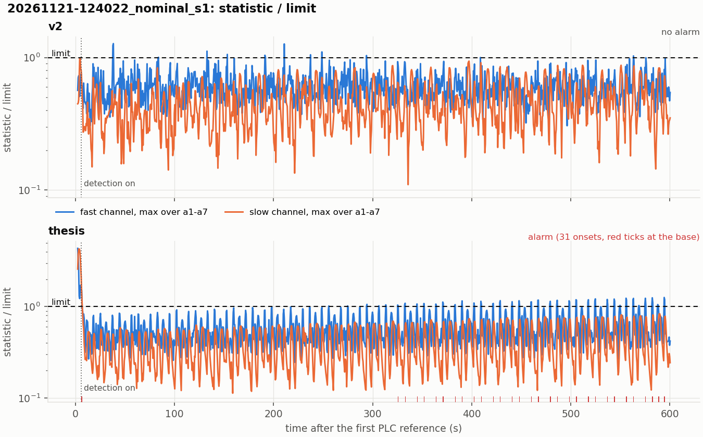
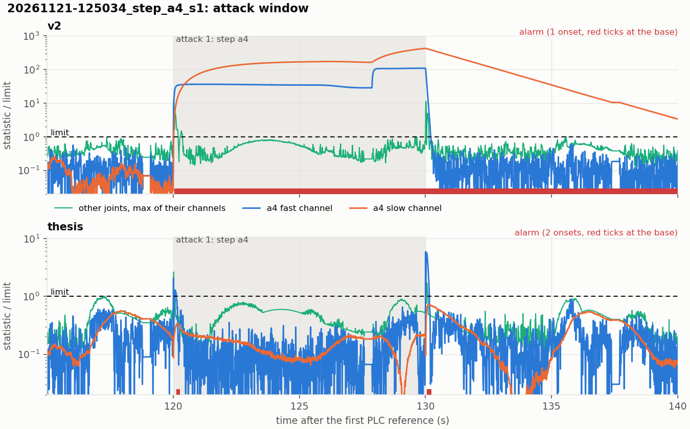
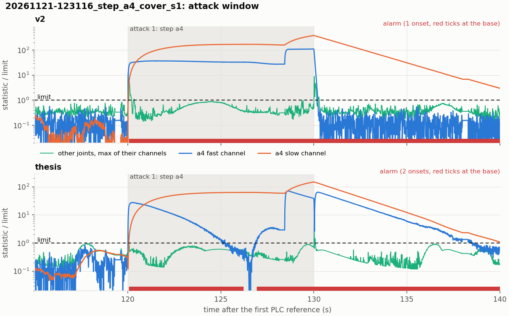
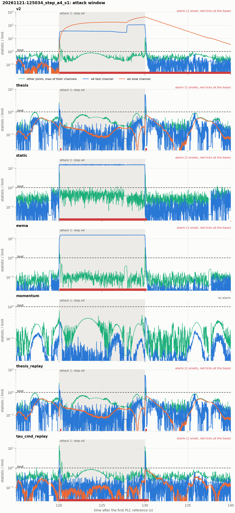
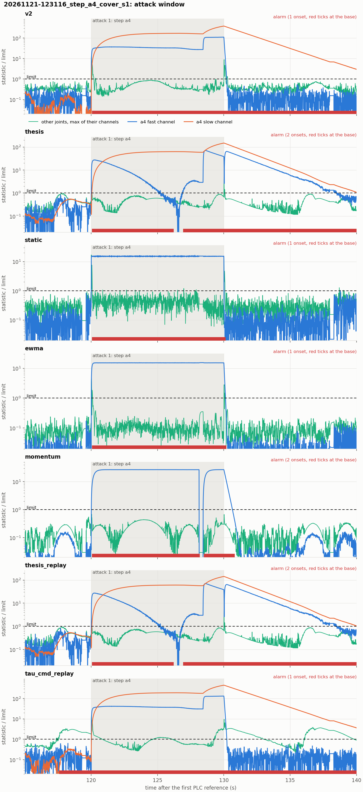
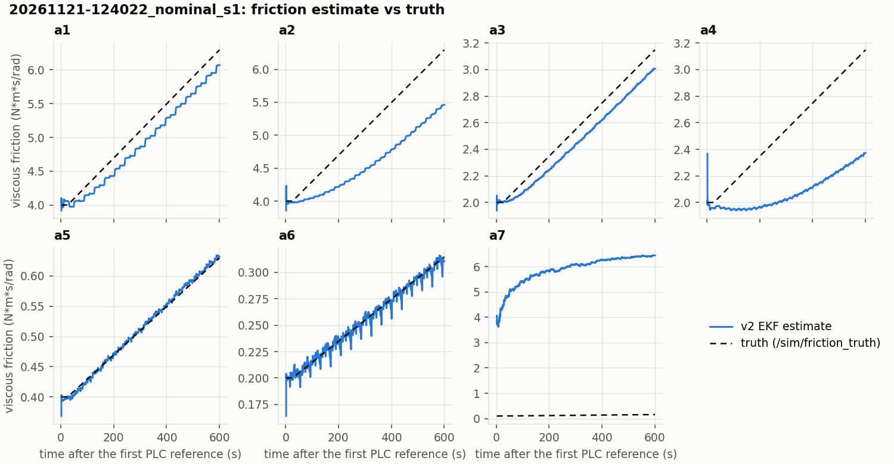

# v1.4.0 · `v1.4-ids-attacks-eval` — harder attacks, and a proper way to score them

| | |
|---|---|
| **Release** | `v1.4.0`, branch `v1.4-ids-attacks-eval`, built on `v1.2.0` |
| **Change IDs** | C18 evaluation, C19 attack library, C20 sweeps, C21 offline replay, C22 baselines, C24 falsified torque report |
| **IDS maths** | Unchanged. v1.2 calibrations stay valid (same fingerprint), and the live IDS was not re-tuned |
| **Measured in Gazebo** | Seed 1, one run each: `nominal` (600 s), `step_a4`, `step_a4_cover` |

> [!IMPORTANT]
> **These results are narrow.** One seed, one joint (a4), one attack size (0.02 rad), 0.165 h of nominal data. Per-hour false-alarm rates computed from a few minutes are shown because the tool computes them, not because they are meaningful yet. Nine of the ten attack kinds and the sweeps are implemented and unit-tested but **not run in simulation**.

---

## Contents

1. [What this release adds](#1-what-this-release-adds)
2. [The ten attack kinds and the torque cover](#2-the-ten-attack-kinds-and-the-torque-cover)
3. [How a run is scored](#3-how-a-run-is-scored)
4. [Results](#4-results)
5. [What the results say](#5-what-the-results-say)
6. [Problems found and fixed](#6-problems-found-and-fixed)
7. [Known limits and open items](#7-known-limits-and-open-items)
8. [Reproduce the runs](#8-reproduce-the-runs)
9. [What comes next](#9-what-comes-next)

---

## 1. What this release adds

v1.2 showed that the IDS catches one setpoint attack and stays quiet under wear. v1.4 makes the attacker stronger and the measurement repeatable:

| Piece | Package | What it gives |
|---|---|---|
| **Attack library** (C19) | `ids_attacks` | Ten attack kinds with per-sample ground truth, plain Python, reusable by later transports (Modbus proxy, PLC update) |
| **Torque cover** (C24) | `ids_attacks`, `ids_experiments`, `ids_bringup` | The MitM also relays the robot's measurements and rewrites the reported torque, so the IDS command check sees nothing |
| **Sweeps** (C20) | `ids_bringup` | `sweeps:` in `campaign.yaml` expand kind × joints × magnitudes into named runs (`step_sweep_a4_m0.01`) |
| **Offline replay** (C21) | `ids_core`, `ids_ros` | `ids_replay` runs the live IDS code over recorded arrays: re-score, calibrate from any nominal run, try other settings |
| **Evaluation** (C18) | `ids_evaluation` | Bag → arrays, detection and latency per attack, false alarms per hour, attribution, figures, Markdown/CSV report |
| **Baselines** (C22) | `ids_evaluation` | Static threshold, single EWMA, thesis and commanded-torque replays, momentum observer, all on the same data |



## 2. The ten attack kinds and the torque cover

Effect on the setpoint of each attacked joint; t is the time since the attack started and m its magnitude.

| Kind | Effect | Scenario in `campaign.yaml` | Why it is interesting |
|---|---|---|---|
| step | q += m | `step_a1` … `step_a7` (0.02 rad) | The dissertation's case |
| ramp | q += m·t | `ramp_a1` … `ramp_a7` (0.001 rad/s, 30 s) | Slow, close to wear |
| sine | q += m·sin(2πft) | `sine_a4` (0.01 rad, 0.5 Hz) | Zero mean |
| scaling | q = q₀ + m·(q − q₀) | `scaling_a4` (1.05) | Proportional to the motion |
| freeze | hold the setpoint at the attack start | `freeze_a4` | The arm stops; nothing looks noisy |
| replay | loop the trusted setpoints of the last `lag` s | `replay_a4` (4 s) | Genuine-looking motion at the wrong time |
| delay | forward each setpoint `lag` s late | `delay_a4` (0.2 s) | Small, smooth error |
| noise | q += N(0, m²), seeded | `noise_a4` (0.002 rad) | Looks like sensor noise |
| coordinated | q += mᵢ on several joints | `coordinated_a2a4` | Spreads the attack over joints |
| drift_mimic | q −= c(t)·v, c(t) = m·t/duration: a torque Kp·c(t)·v that looks like growing viscous friction | `drift_mimic_a4` (0.002 s) | Tries to hide inside the wear the IDS learns |

**The cover (C24).** The controller's torque is Kp·(q_ref − q) + Kd·(v_ref − v) + g(q). A falsified setpoint (Δq, Δv) adds Kp·(Δq + Δv·dt) + Kd·Δv. In a covered run the controller publishes on `/robot/measurement_raw`; the MitM removes that extra torque and republishes on `/robot/measurement`. In the measured run the report on a4 was lowered by exactly 12.00 N·m (600 × 0.02) in the 1000 windows of the attack and nowhere else; positions and velocities were untouched.

## 3. How a run is scored

- **Detected:** an alarm onset falls in [start, end + 1 s]. **Latency:** onset − start (0 if an alarm was already active). **Before attack end:** the onset came while the attack was active, not from the step back.
- **Attributed:** the primary joint at onset is an attacked joint.
- **False alarm:** an onset after the warm-up and outside every [start, end + 30 s]; rate per hour of the time that is left.
- **Excluded:** runs whose summary reports torque at an effort limit.
- **Baselines:** same debounce (5) and hysteresis (0.5) as the IDS; limit = the lowest one with no alarm on the first 123 s of `nominal` (favourable to the baseline). That part of `nominal` is not scored for any detector in the comparison.
- **Time zero** is the first trusted reference. The IDS log prints simulation time; subtract the first reference (about 4 s) to compare.

## 4. Results

### 4.1 Headline

| | v2 IDS | Dissertation design (thesis mode) |
|---|---|---|
| `nominal`, 600 s of wear | **0 false alarms** (0.165 h) | 31 false alarms, 30 of them after 325 s |
| `step_a4`, +0.02 rad, 120–130 s | **detected in 44 ms, on a4** | detected in 114 ms, on a4 |
| `step_a4_cover`, same + falsified torque | **detected in 50 ms, on a4**, physics channel only | detected in 50 ms, on a4 |

### 4.2 Every detector on the same recordings

Training: first 123 s of `nominal`. Held-out nominal: 0.131 h.

| Detector | `step_a4` latency | `step_a4_cover` latency | False alarms: held-out nominal | in `step_a4` | in `step_a4_cover` |
|---|---|---|---|---|---|
| v2 (live) | 0.044 s, a4 | 0.050 s, a4 | 0 | 0 | 2 (a1, B16) |
| thesis (live) | 0.114 s, a4 | 0.050 s, a4 | 30 | 0 | 1 |
| static threshold | 0.044 s, a4 | 0.050 s, a4 | 1 | 0 | 0 |
| single EWMA | 0.044 s, a4 | 0.050 s, a4 | 1 | 0 | 0 |
| momentum observer | **missed** | 0.050 s, a4 | 0 | 1 | 1 |
| v2 replay | 0.044 s, a4 | 0.050 s, a4 | 0 | 0 | 2 |
| thesis replay | 0.114 s, a4 | 0.050 s, a4 | 25 | 0 | 1 |
| commanded-torque replay | 0.044 s, a4 | already alarmed, a6 (wrong joint) | 2 | 0 | 18 |

Baseline limits (standardised units): static 4.249, EWMA 12.714. Replay calibrations reproduced the live limits exactly (v2 4.127 / 5.093, thesis 3.968 / 4.866).

### 4.3 Replay fidelity

How closely `ids_replay` reproduces the live disturbance estimate, window by window:

| Run | v2: windows within 1e-3 N·m | thesis |
|---|---|---|
| `nominal` | 100.0 % | 100.0 % |
| `step_a4` | 99.9 % | 100.0 % |
| `step_a4_cover` | 98.9 % | 99.0 % |

Every replay raised its alarm in the same window as the live IDS. The small differences are expected where message arrival order in the live system differs from the stamp order the replay assumes; the covered run, where measurements take an extra hop through the MitM, shows the most.

### 4.4 Friction under wear (v2, `nominal`, last 10 s of 600 s)

| Joint | a1 | a2 | a3 | a4 | a5 | a6 | a7 |
|---|---|---|---|---|---|---|---|
| Estimate / truth − 1 | −3.3 % | −13.1 % | −4.4 % | −24.6 % | +0.6 % | −2.2 % | +4004 % |

The truth now comes from the simulator (`/sim/friction_truth`) and equals the configured wear schedule. a7 hardly moves in this program, so its friction cannot be learned; a2 and a4 lag behind the growing wear (B24). Neither affected detection here: the highest nominal readings of v2 were 1.27× (fast) and 0.99× (slow) the limit, without a debounced alarm.

### 4.5 Graphs



*`nominal`, 600 s of wear. v2 (top) stays below its limit (dashed line); thesis mode (bottom) alarms more and more as friction grows (red ticks).*



*`step_a4`. Grey band: the attack. a4's fast and slow readings jump two orders of magnitude above the limit within 44 ms; other joints stay below it.*



*`step_a4_cover`. Same attack, torque report falsified. v2 still detects within 50 ms from the motion alone.*



*`step_a4`, every detector of §4.2. The momentum observer (driven by the measured torque, which follows the controller) barely moves: a setpoint attack is not an external force.*



*`step_a4_cover`, every detector. Here the momentum observer reacts, because the falsified torque report is its own input.*



*v2 friction estimates against the simulator's truth during `nominal`.*

## 5. What the results say

- **The trusted-reference design survives a torque cover.** Hiding the torque removed the command-check evidence (the alarm mask showed `command 0000000`, against `0001000` without the cover), yet the physics channel still alarmed in 50 ms. This is the point of predicting the motion from the trusted PLC reference rather than trusting what the robot reports.
- **The momentum observer, the classical residual of v1, cannot see a setpoint attack.** It only reacts when the attacker tampers with the torque report it relies on.
- **Simple thresholds on the same disturbance estimate are fast but less quiet.** With the most favourable limit they still raised a false alarm in 0.131 h of held-out wear, where v2 raised none. Much more data is needed before this is a rate.
- **The dissertation design detects this attack in some runs and not others** (missed by one window in v1.2, 114 ms here) and its false alarms grow with wear, as expected without a friction model.
- **The commanded-torque variant is unstable from run to run** (0 to 18 false alarms), so the trusted reference, not only the friction states, is what keeps v2 quiet.

## 6. Problems found and fixed

From the v1.4 iteration log (numbered from B1 again):

| # | Problem | Fix |
|---|---|---|
| B1 | A replay test read a zero limit | Read it from the calibrating replay |
| B2 | Momentum observer showed 15.7 N·m without an external torque | Stable test plant; trapezoid integration (< 0.1 N·m) |
| B3 | Wrong payload mass in the momentum baseline | Mass when the context is non-zero |
| B4 | Friction truth read from the wrong columns and clock | Coefficient columns, header stamp |
| B8 | The thesis alarm at the step back counted as a 10 s detection | "Before attack end" column; saturated runs excluded |
| B10 | `--train <run folder>` did not match | Compare folder names |
| B13 | The pushed v1.2 branch lacked the `ids_core` test URDF | `.gitignore` rule anchored to the root (`/data/`) |
| B14, B15 | Hand-edited comments changed and truncated code, and dropped final newlines | Files restored; this release's commented files replace them |

## 7. Known limits and open items

| Item | Status |
|---|---|
| One seed, joint a4 only, 0.165 h of nominal | Results backlog |
| Nine attack kinds, the ramp, the other joints and the sweeps not run in simulation | Results backlog |
| B11: replay assumes references arrive by their stamp (≥ 98.9 % agreement) | Known limitation |
| B12: commanded-torque baseline varies between runs | Baseline result |
| B16: two a1 alarms 31 s and 50 s after the covered attack | One run; repeat over seeds |
| B17: harmless shutdown warning from the planner | Revisit in v1.6 |
| B24: friction lag under wear (a4 −24.6 % at 600 s); a7 unobservable | Estimator decision, needs approval |
| B4 (v1.2): onset inside a window can flag a second joint briefly | Results backlog |
| C23 MEWMA, C25 minimum-detectable-attack curves | Not in v1.4 |
| The cover assumes a white-box attacker who knows the controller gains | Design assumption |

## 8. Reproduce the runs

**Windows PowerShell**, in the repository folder: `docker compose up -d robot ids`

```bash
# IDS terminal (docker compose exec ids bash): build, test, start both IDS instances armed
cd /ws && colcon build --packages-up-to ids_ros && source install/setup.bash
colcon test --packages-select ids_core ids_ros && colcon test-result --verbose
ros2 launch ids_ros ids.launch.py

# robot terminal: build, test, run, score
cd /ws && colcon build --packages-up-to ids_bringup ids_evaluation && source install/setup.bash
colcon test --packages-select iiwa_controllers ids_attacks ids_experiments ids_bringup ids_evaluation
colcon test-result --verbose
ros2 run ids_bringup run_campaign --only nominal step_a4 step_a4_cover --seeds 1 --rerun
R=$(ls -d /ws/data/runs/*_nominal_s1 | tail -1); S=$(ls -d /ws/data/runs/*_step_a4_s1 | tail -1)
C=$(ls -d /ws/data/runs/*_step_a4_cover_s1 | tail -1)
ros2 run ids_evaluation evaluate $R $S $C --out /ws/data/eval_v14
ros2 run ids_evaluation compare_baselines $R $S $C --train $R --out /ws/data/compare_v14
```

A calibration is needed once (see [README_REFINED §14](../README_REFINED.md#14-running-experiments)); a v1.2 calibration is accepted unchanged.

## 9. What comes next

| Release | Adds |
|---|---|
| **v1.6.0** `mp-sros2` | SROS2 security, a rogue node without credentials, a stolen-credential MitM, the IDS → robot halt chain |
| **v1.8.0** `mp-ot-network` | OpenPLC, Modbus, an attacker proxy (reusing `ids_attacks`), an HMI and a recording range |
| **v2.0.0** `mp-release` | Hardened CI, full documentation, merge into `main` |

After v2.0, the results backlog turns these single runs into rates: seeds 1–3, every attack kind on every joint, the sweeps and their minimum-detectable-attack curves, all scored with `ids_evaluation`.
